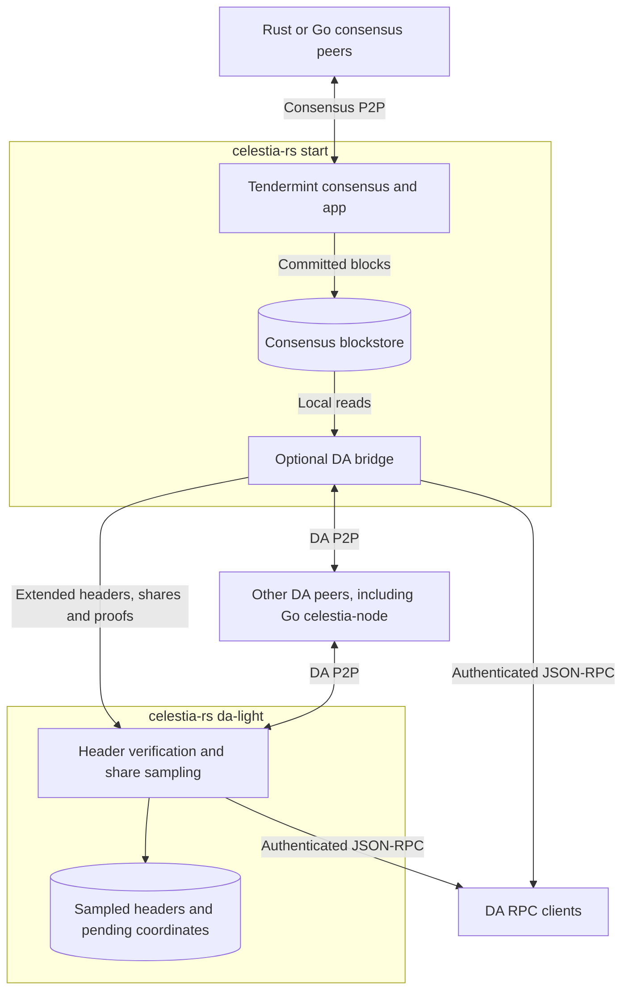

# celestia-rs

`celestia-rs` runs a Celestia consensus node, an optional data availability
(DA) bridge and a standalone DA light node from one Rust binary. Its consensus
node is wire- and consensus-compatible with Go
[celestia-app](https://github.com/celestiaorg/celestia-app) and
[celestia-core](https://github.com/celestiaorg/celestia-core). The DA roles
interoperate with Go [celestia-node](https://github.com/celestiaorg/celestia-node)
over the DA peer and RPC protocols exercised by the
[mixed-node conformance suite](conformance/da/README.md).

[Operator website](https://celestiaorg.github.io/celestia-rs/) · Quickstart, DA bridge setup, performance charts and operator FAQ.

## Install

```sh
curl --proto '=https' --tlsv1.2 -sSf https://raw.githubusercontent.com/celestiaorg/celestia-rs/main/scripts/install.sh | sh
```


## Status

**celestia-rs is an early, experimental project under rapid development.**
Expect breaking changes and rough edges, and don't rely on it for production
yet. Feedback, bug reports and questions are very welcome: please open an
issue.

celestia-rs runs a validator on both Mocha and Mainnet, signing blocks
alongside the Go validators:

| Network | Validator |
|---|---|
| Mocha | [Mocha validator](https://mocha.celenium.io/validator/122597103?tab=proposed+blocks) |
| Mainnet | [Mainnet validator](https://celenium.io/validator/1499834894?tab=proposed+blocks) |

General mainnet recommendation for non-archival RPC nodes, full consensus
nodes and validators is pending qualification. See [ADR 0008](docs/adr/0008-mainnet-recommendation.md) for scope
and evidence requirements.

See the [milestones](MILESTONES.md) for qualification progress and the
[open questions](OPEN_QUESTIONS.md) for outstanding owner decisions.

## Goals

- **Faster than the Go consensus node:** see
  [Performance vs Go](#performance-vs-go).
- **Minimal dependencies:** every external crate is a potential supply chain
  attack vector, so we keep the dependency tree small. Long term, the goal is
  to keep reducing the number of external dependencies this repo relies on.

## Features

- **Full node and validator in Rust:** ABCI++ app, Tendermint BFT consensus
  (celestia-core semantics, incl. block propagation), P2P (secret
  connection, MConn, PEX), CAT mempool, block sync, state sync, evidence,
  Tendermint light client for state sync.
- **Interoperates with Go nodes:** peers, gossips blocks and txs, and reaches
  consensus in mixed Go + Rust validator sets.
- **App-hash parity with Go**, checked by replaying a corpus of devnet
  scenarios recorded from Go (staking, gov, authz / feegrant, vesting,
  blobs, fibre, IBC, hyperlane, evidence, upgrades), by following Mocha and mainnet, and by nightly
  differential fuzzing against Go.
- **Go-compatible operator surface:** CLI (`init`, `keys`, `genesis`, `tx`,
  `query`, …), Go keyrings, RPC, gRPC and REST responses checked against Go,
  pruning, Prometheus metrics, double-sign protection.
- **Built for a Mac Mini M4** (16 GB / 512 GB, [`docs/hardware.md`](docs/hardware.md)):
  release archives for macOS and Linux, launchd and systemd units.

## Architecture

| Role | Command | What it does |
|---|---|---|
| Consensus full node or validator | `celestia-rs start` | Executes blocks and maintains application state. A validator also participates in consensus voting. |
| DA bridge | `celestia-rs start` with a bridge listener | Reads committed blocks from the local blockstore, indexes verified extended headers, and serves DA peer requests or authenticated DA JSON-RPC on the configured listeners. |
| DA light node | `celestia-rs da-light` | Runs in a separate process and home. It follows signed headers from a trust anchor, verifies randomly selected shares and stores sampled headers. |



The bridge-to-light connection uses DA libp2p. The light node can sample via
DA peers independently of the bridge shown here. See the
[operator guide](docs/operator-guide.md#3-quick-starts) for listener
configuration, data retention and trust inputs.

## Performance vs Go

The current operator benchmark target is [celestia-app v11.0.0](https://github.com/celestiaorg/celestia-app/releases/tag/v11.0.0).
The [operator comparison protocol](docs/benchmarks/operator-sync.md) covers snapshot and genesis sync to tip, RAM and disk usage. Results are pending.

### Historical Mac Mini M4 results

The October 20 reference run used release builds on the same Mac Mini M4
(16 GB RAM, 256 GB SSD) with Go celestia-appd v10.4.0 and celestia-rs
`fb42fd2`. The recorded workload covered 511 heights and 386,980
transactions, with blocks up to 28.2 MiB. Both implementations matched
every recorded app hash. See the [benchmark report](docs/benchmarks/README.md#results-mac-mini-m4-2026-10-20-b1-reference)
for the method and caveats.

| | Go | Rust | |
|---|---|---|---|
| Block execution (FinalizeBlock + Commit) | 1,189 tx/s | 4,765 tx/s | 4.0x faster |
| CheckTx, new txs | 6,391 tx/s | 13,178 tx/s | 2.1x faster |
| State sync to first block | 40.8 s | 11.6 s | 3.5x faster |
| Block sync (511 heights) | 186.6 s | 134.4 s | 28% less time |
| Memory (RSS after block sync) | 2,373 MB | 1,381 MB | 42% less |
| App state on disk after replay | 456 MB | 487 MB | 7% larger |
| PrepareProposal, max-size squares (median) | 205.6 ms | 211.6 ms | 3% slower |
| ProcessProposal, max-size squares (median) | 211.9 ms | 58.1 ms | 3.6x faster |

## Getting started

Install a release ([above](#install)), or build from source:

```
cargo build --locked --release -p celestia-rs --features da-light
```

Release builds from v0.1.0-rc.8 include both experimental DA roles. The
`da-light` build feature includes the bridge, and `start` enables each DA
listener only when configured.

- [Run a consensus node](docs/operator-guide.md#3-quick-starts) or follow the
  validator runbooks for [Mocha](docs/operator-guide.md#11-running-a-mocha-validator-on-a-mac-m13)
  and [mainnet](docs/operator-guide.md#12-mainnet-validator-m14).
- [Run an integrated DA bridge](docs/operator-guide.md#experimental-da-bridge-on-a-private-network).
- [Run a standalone DA light node](docs/operator-guide.md#standalone-da-light-node).

## Development

```
cargo test --workspace
cargo xtask repo-health --offline   # local gate
cargo xtask refresh-fixtures        # regenerate Go fixtures (needs Go)
```

The [static analysis workflow](.github/workflows/static-analysis.yml) runs
Rust CodeQL scanning and Kani proofs for the `shares` crate. CodeQL findings
appear under Security → Code scanning. To run the same Kani proofs locally on
Linux or macOS:

```sh
cargo install --locked kani-verifier --version 0.68.0
cargo kani setup
cargo kani -p shares
```

`crates/` holds the workspace, tiered from primitives up to the node
binary; `conformance/` the Go fixture generators and devnet harness;
`docs/` the [design](docs/specs/2026-05-14-celestia-rs-design.md),
[ADRs](docs/adr/), benchmarks and [security notes](docs/security.md).

Reliability metrics, coverage budgets and fuzz evidence:
[`docs/quality.md`](docs/quality.md).

## License

Dual-licensed under [Apache 2.0](LICENSE-APACHE) and [MIT](LICENSE-MIT).
