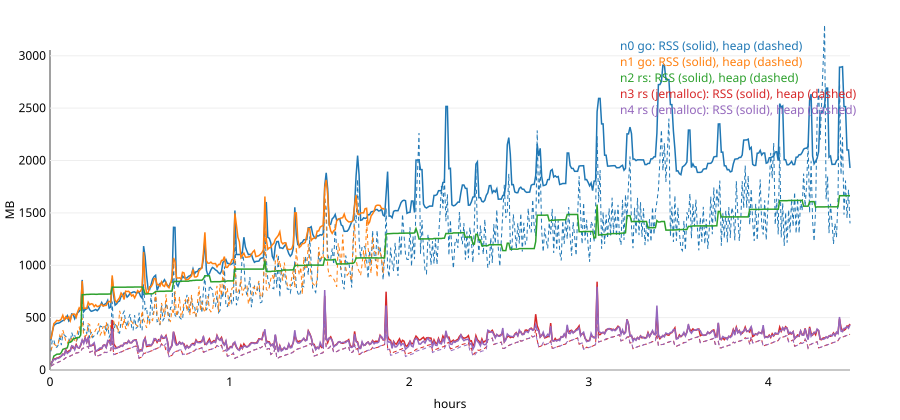

# Memory: long single-lifetime soak (2026-10-15)

**Result: no leak in celestia-rs.** Over a 4.5 h single-lifetime run under
steady load, the live heap of the Rust nodes levels off at ~340 MB, of which
~245 MB are the bounded RocksDB caches; its growth over the last 2 h was
+4.5 MB/h. The RSS growth the chaos soak saw (0.84 -> 1.43 -> 0.98 GB per
Rust lifetime) was **glibc malloc fragmentation**: on the same workload the
glibc build's RSS kept rising to 4.9x its live heap (1.66 GB for ~340 MB
live), while jemalloc builds held RSS at ~1.3x the heap (430-440 MB).
**Fix: celestia-rs now uses jemalloc as its global allocator by default**
(feature `jemalloc`), with `--features memstats` for heap gauges and
jemalloc's heap profiler.

## Setup

`SOAK_PROFILE=memory conformance/devnet/soak.sh` (see
`conformance/devnet/README.md`): no chaos, so every node keeps one
lifetime; same workload as the chaos soak.

| | |
|---|---|
| Nodes | V0, V1 Go celestia-appd v10.4.0 validators; V2, V3 Rust validators; F4 Rust full node (all links through the soak proxy, no faults injected) |
| Rust builds | V2: system allocator (glibc malloc; the default build before this change). V3, F4: `--features memstats` (jemalloc + statistics); V3 also with jemalloc heap profiling (`MALLOC_CONF=prof:true,lg_prof_sample:20,lg_prof_interval:35`) |
| Load | 25 bank sends/s round-robin over every node's RPC; PFB rounds every 8-20 s (1 B-600 KB blobs), every 10 min a near-max round (8 x 1.9 MB or 3 x 7.3 MB: 128x128-256x256 squares); staking delegate / redelegate / unbond / withdraw; gov `MsgUpdateBlobParams` proposals with validator votes |
| Run | 4.46 h, 4,855 heights, 384,795 txs, 25 blocks over 8 MiB (max 21.2 MiB), 31 gov proposals decided (21 passed, 10 rejected as voted), no stall, every height's block / app hash identical on all nodes |
| Sampling | every 30 s per node (`mem.jsonl`): RSS / RssAnon / RssFile / VmHWM, threads, open fds, `du data/`, and the Prometheus memory gauges: Rust `memstats_*` (jemalloc heap, RocksDB block cache + memtables per database, IAVL node cache length, mempool), Go `go_memstats_*` |
| Pruning | app state keep 100 / interval 10, `min-retain-blocks` 150 (raised to 3000 by celestia-app, both Go and Rust), snapshots every 100 heights on every node |

V1 (Go) was killed at 1.87 h by the out-of-memory killer of the 14.3 GB
cgroup the VM shares with other jobs (its RSS was 1.8 GB and growing);
the chain kept committing on the remaining 3/4 of the power. V1 was also the
soak's tx-index node, so the PFB / staking "lost" counts in the soak report
after that point are an accounting artifact, not lost txs. Two shorter runs
before this one (1.0 h and 1.4 h, ended by the disk guard) showed the same
picture.

## Results

Steady state = after the first 30 min. Growth is the least-squares slope
over the steady state and over its second half.

| node | build | RSS start -> end | RSS peak | RSS growth MB/h (all / last half) | live heap start -> end | heap growth MB/h (all / last half) | threads | fds | data/ start -> end |
|---|---|---|---|---|---|---|---|---|---|
| V0 | Go | 702 -> 1929 MB | 2910 MB | +363 / +216 | 384 -> 1399 MB (`heap_inuse`) | +288 / +207 | 11-13 | 57-98 | 210 -> 1228 MB |
| V1 | Go (killed at 1.87 h) | 752 -> 1532 MB | 1815 MB | +579 / +555 | 448 -> 1190 MB | +489 / +294 | 12 | 72-93 | 301 -> 1068 MB |
| V2 | Rust, glibc malloc | 792 -> **1664 MB** | 1664 MB | **+207 / +192** | (not instrumented; same code and load as V3) | | 22-28 | 47-63 | 237 -> 1142 MB |
| V3 | Rust, jemalloc | 192 -> **439 MB** | 843 MB | +34 / **+4.5** | 120 -> 342 MB (`allocated`) | +31 / **+4.5** | 24-25 | 47-64 | 237 -> 1142 MB |
| F4 | Rust, jemalloc | 183 -> **431 MB** | 795 MB | +35 / **+5.6** | 119 -> 342 MB | +32 / **+5.6** | 24-28 | 47-63 | 238 -> 1141 MB |



**Where the Rust heap goes** (V3 at the end, 342 MB allocated): RocksDB
block caches + memtables 244 MB (block store 117, application 64, state 63;
all bounded by `--db-cache-mib` / the 64 MiB node-store caches plus two
memtables each), IAVL node cache 68k of its 1M-node capacity, ~98 MB
everything else (mempool, consensus, propagation, p2p, RPC). Heap minus
RocksDB caches went 62 -> 98 MB over the first 2.7 h (IAVL node cache
filling: 58k -> 68k nodes, 1M max) and was flat after that. jemalloc heap
profile diffs between consecutive dumps of V3 (one dump per 32 GiB
allocated, ~every 11 min) attribute the net growth to
`rocksdb::BlockBasedTable::MaybeReadBlockAndLoadToCache` and table readers'
filter blocks (the block cache filling) and IAVL `put_node` (node cache);
no Rust collection grows. Spikes in the snapshots are in-flight proposals
(`create_proposal_block`, blob tx parsing in PrepareProposal).

Structures checked by counters or code review (all bounded or pruned per
height / per peer): CAT mempool (`TxPool` size + seen / rejected caches,
`received_haves` capped per peer), propagation (`proposals` and per-peer
state pruned below the committed height, unverified compact blocks per
peer), consensus vote sets (per height), evidence pool (expiry by height and
time), RocksDB block cache / memtables (gauged), IAVL node cache (gauged),
RPC event bus subscriptions (per connection), p2p send queues (per peer,
bounded channels). Threads (24-28) and open files (47-64, RocksDB SSTs) are
flat.

**glibc malloc.** V2 runs the same code with the same live heap as V3/F4,
but its RSS rose without levelling off (+192 MB/h in the last 2 h, 4.9x the
live heap at the end). The same ratio shows up off-network: replaying the
first 39 heights of the benchmark chain (`conformance/bench/`) through
`celestia-rs abci` ends at 1,157 MB RSS on glibc, 717 MB with
`MALLOC_ARENA_MAX=2`, and 530 MB on jemalloc for an identical ~215 MB live
heap (jemalloc heap profile). glibc keeps per-thread arenas whose freed
chunks are not returned while long-lived allocations (IAVL nodes, cache
blocks) pin their pages; the node's many threads (RocksDB background jobs,
tokio, reactors) and its mix of 16 KB-30 MB allocations (blocks, shares,
erasure-coded parts) make that worst case common. jemalloc is now the
default (`crates/tier-5-node/celestia-rs/Cargo.toml`: `default = ["rocksdb",
"jemalloc"]`; unprefixed on Linux so RocksDB's C++ allocations use it too;
on macOS only Rust allocations go through it and RocksDB keeps the system
zone allocator). `--no-default-features --features rocksdb` keeps the
system allocator. The phase A benchmark (`docs/benchmarks/README.md`) runs
the jemalloc build; a glibc-vs-jemalloc timing comparison on the full
replay was cut short by the shared machine's disk limits and is part of the
pending Mac run (`CELESTIA_RS_ALT`). macOS's allocator differs from glibc,
so the memory soak should also be repeated there.

**Go for comparison.** Go's live heap (`go_memstats_heap_inuse_bytes`)
grew 384 -> 1,399 MB on V0 and was still growing at +207 MB/h in the last
2 h; RSS 1.9 GB (peak 2.9 GB). The Rust nodes end at ~22% of Go's RSS.

**Disk.** Block stores grow until height 3000 (celestia-app's minimum
`min-retain-blocks`), drop when pruning starts, then refill the 3000-block
window: 1.14 GB per Rust node and 1.23 GB on the Go validator at 4,855
heights; app state stays at ~100 versions.

## Reproduce

```bash
cargo build --release -p celestia-rs                      # default: jemalloc
cp target/release/celestia-rs /tmp/celestia-rs
cargo build --release -p celestia-rs --features memstats  # heap gauges + profiler
cp target/release/celestia-rs /tmp/celestia-rs-memstats
SOAK_PROFILE=memory SOAK_SECS=21600 SOAK_RETAIN_BLOCKS=150 SOAK_BIG_EVERY=600 \
  CELESTIA_RS=/tmp/celestia-rs SOAK_RS_N3=/tmp/celestia-rs-memstats SOAK_RS_N4=/tmp/celestia-rs-memstats \
  SOAK_ENV_N3="MALLOC_CONF=prof:true,lg_prof_sample:20,lg_prof_interval:35,prof_prefix:/tmp/jeprof/n3" \
  DEVNET_BIN=<dir> DEVNET_PORT_OFFSET=21000 SOAK_DIR=/tmp/memsoak conformance/devnet/soak.sh
python3 conformance/devnet/soak/memreport.py /tmp/memsoak --svg rss.svg
# heap growth between two profile dumps (jeprof ships with tikv-jemalloc-sys):
jeprof --text --cum --show_bytes --base=/tmp/jeprof/n3.<pid>.2.i2.heap /tmp/celestia-rs-memstats /tmp/jeprof/n3.<pid>.9.i9.heap
```

Budget it: ~1.2 GB of disk per node at 3000 retained heights with this
load, ~2 GB of RAM per Go node and 0.5 GB per Rust node.
