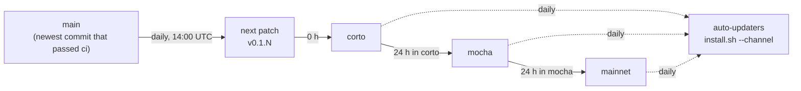

# Releasing celestia-rs

A release is a version of the `celestia-rs` binary crate
(`crates/tier-5-node/celestia-rs/Cargo.toml`), a `v<version>` tag on the
commit that carries it, and a GitHub release with the archives that
`scripts/install.sh` installs. `celestia-rs version` prints the release
version, so all three always agree. No one pushes tags or edits versions by
hand.

The other workspace crates are `publish = false` and stay at 0.0.1; only
the binary is versioned.

Versions are plain semver, `v<major>.<minor>.<patch>`, with no release
candidates:

- **Daily releases**, of the newest `main` commit that passed `ci`. No one
  cuts them. Their version comes from the commits since the last release
  (see "Version numbers" below): `v0.1.0`, `v0.1.1`, ... and `v0.2.0` after
  a breaking change.
- **v1.0.0**, cut by a human with the **prepare release** workflow below.
  Daily releases never reach 1.0 on their own.

### Version numbers

PRs are squash-merged, so a PR's title is its commit's subject. The
`pr-title` check requires a conventional commit:
`<type>[(scope)][!]: <description>`, with type one of `feat`, `fix`,
`perf`, `refactor`, `docs`, `test`, `ci`, `build`, `chore`, `style`,
`revert`. Mark a breaking change with `!` (`feat(cli)!: drop --foo`) or a
`BREAKING CHANGE:` footer. A breaking change is one an operator must act
on: a removed or renamed flag, config key or RPC field, an on-disk format
change, or a consensus-breaking change.

The daily release reads the commits since the last release
(`.github/scripts/release_version.py`):

| | breaking change | `feat` | anything else |
| --- | --- | --- | --- |
| before 1.0 | minor (`0.1.4` → `0.2.0`) | patch | patch |
| from 1.0 | major | minor | patch |

The release notes group the same commits under Breaking changes, Features,
Fixes and Other changes. A minor bump before 1.0 therefore always means
"read the breaking changes before you upgrade".

Nodes do not track "the newest release". They follow a **release
channel**, one per network, which moves forward on its own as releases
soak on the network before it.

## Automatic releases and release channels



**Automatic releases.** Every day at 14:00 UTC, `release.yml` takes the
newest `main` commit whose `ci` push run passed and, if no release has it
yet, tags it with the next version (see "Version numbers"; with no
release yet, the crate version's `<major>.<minor>.<patch>`: crate
`0.1.0-rc.9` gives `v0.1.0`). A re-run of a failed daily run resumes the
same tag. It builds, smoke-tests and publishes the archives. The
release's title is its tag. No release is marked GitHub's "Latest" when
published: **release channels** marks the `mainnet` channel's release
Latest, so `github.com/<repo>/releases/latest` and `install.sh` without
`--channel` give the release Mainnet runs. One release a day, not one per merge, keeps release
builds (three targets, one on macOS) from competing with PR CI for runners;
nodes update daily and channels soak for 24 hours, so more frequent
releases would not reach them sooner. The build sets `CELESTIA_RS_RELEASE_VERSION`, so
`celestia-rs version`, `--version` and `version --long` report the release
version (the crate version in `Cargo.toml` is only a floor); `build.rs`
rejects a value that is not a plain `<major>.<minor>.<patch>` at or above
the crate version. A commit that changes the
crate version is left to the human release path.

**Channels.** `.github/release-channels.json` is the policy. Each channel
has a source and a soak time:

| channel | source | soak |
| --- | --- | --- |
| `corto` | releases | 0 h |
| `mocha` | `corto` | 24 h |
| `mainnet` | `mocha` | 24 h |

Every hour, **release channels** (`release-channels.yml`) moves each
channel to the newest release that has been in its source for at least the
soak time, is not yanked, and is not newer than what the source runs now.
"Newest" means latest on `main` (the commit's position), not latest
published: automatic builds run in parallel and can publish out of order.
It never moves a channel backwards. `main` is linear, so a release that
entered `mocha` 24 hours ago has run there, inside every later release, for
24 hours; frequent merges do not starve `mainnet`. The state is on the
`release-channels` branch: `channels.json` (tags, history, frozen channels,
yanked releases) and `channels/<name>`, one file holding the tag. Each
change is a commit signed by GitHub, so the branch is the audit log.

**Following a channel.**

- Any machine: `install.sh --channel mainnet` (or
  `CELESTIA_RS_CHANNEL=mainnet`) installs the channel's release; re-run it
  to follow.
- Linux, unattended: `packaging/linux/celestia-rs-auto-update.{sh,service,timer}`.
  Once a day, at a random time in a 6-hour window so that operators do not
  restart together, it installs the channel's release with that release's
  own installer, restarts `celestia-rs`, waits until the node is caught up
  and advancing, and rolls back to `celestia-rs.prev` if not. Installation
  steps are in the `.service` file.
- The Mac validator host: `packaging/macos/celestia-rs-auto-update.sh` puts
  each node on its own network's channel (`mocha`, `mainnet`;
  `CHANNEL_<node>` overrides it), builds the exact tagged source, and keeps
  its canary, app-hash and signing checks.

**When something goes wrong.** Use **Actions → release channels → Run
workflow**:

- `yank <tag>`: no channel takes that release again. Yank every release
  from the bad one up to the fix.
- `pin <channel> <tag>`: set a channel to a release now, for example to
  roll `mainnet` back. Pinning also freezes the channel. Like a promotion,
  a pin needs the release to have been in the channel before for its soak
  time (24 hours in `mocha` for `mainnet`); a rollback to the release
  `mainnet` ran before always passes. Set `force` to skip the check in an
  emergency.
- `freeze <channel>` / `unfreeze <channel>`: stop or resume automatic
  promotion, for example around a network upgrade.

A pinned or frozen source channel also holds back the channels after it,
because a channel never takes a release newer than its source runs. Nodes
pick up a pin at their next daily pass, so after a pin, tell operators to
run the updater or installer at once if the fix is urgent.

**Limits.** Soak time is the only automatic promotion gate. The workflow
cannot see node health, so watch the networks and yank or freeze when they
look wrong. A consensus-breaking release (a new app version) still needs a
coordinated upgrade height: freeze `mainnet` before it reaches the channel
and pin it when the network is ready.

## Release and fix loop

The Mac auto-updater follows each node's release channel, using the exact
tagged source. It runs hourly, deploys to Mocha first, checks health and
app-hash parity, and rolls back an unhealthy deploy before advancing to
mainnet. Unreleased commits on `main` do not deploy.

Keep monitoring and comparisons against Go active as releases advance. When
an issue is found, retain its version, height and reproduction evidence,
fix it with a regression check, and cut the next release through the process
below. Normal updates continue without a multi-day deployment hold. A release
label alone does not establish stability or Go conformance; retained evidence
must keep its actual version, coverage and any gaps.

## Qualifying a release

General mainnet recommendation covers the node roles in
[ADR 0008](adr/0008-mainnet-recommendation.md). A release tag or successful
build does not close the acceptance criteria in `MILESTONES.md`.

Pick the daily release to qualify (for example `v0.1.4`) and retain
evidence against its tagged commit. Run an
individual check with the evidence wrapper, for example:

```sh
python3 scripts/quality/qualify.py --out target/qualification/workspace-tests \
  -- cargo test --workspace --all-features --locked
python3 scripts/quality/qualify.py --out target/qualification/campaign-0 \
  --binary target/release/fuzz-diff \
  --binary target/devnet-bin/celestia-appd \
  --binary target/devnet-bin/v9/celestia-appd \
  -- env DEVNET_BIN="$PWD/target/devnet-bin" \
    crates/fuzz-diff/nightly.sh campaign-0of8 1 target/qualification/findings-0
```

Each output directory must be new. The wrapper retains the command, source
commit/tree, platform/toolchains, exit status, log digest and optional input
binary digests. Dirty source is rejected; a source or input-binary change
during the command invalidates the result even if the command exits zero.
Interrupted checks have no passing completion record. Archive the whole
directory, including the log and each harness's detailed findings. Use the
Go toolchain pinned by the oracle modules, not a newer installed compiler.

Complete every campaign shard with a sufficient budget; summarize volume
with `crates/fuzz-diff/saturation-report.py`. Retain separate evidence for
cross-platform determinism, clean nightly history, coverage, snapshot-based
mainnet-state trials, live replay and independent review. A passing wrapper
record describes one check only. It cannot replace missing F1 evidence or
the required elapsed nights. Publishing or changing a live validator is a
separate operator action.

## Choosing v1.0.0

The first daily release is **v0.1.0**, and breaking changes move daily
releases along 0.x on their own. Reserve **v1.0.0** for a defined compatibility commitment. Record which CLI,
RPC and on-disk interfaces operators can rely on and how upgrades work. For
a general mainnet recommendation, use the repository's C1, F1 and Q1 exit
criteria and link their candidate-specific evidence. [Milestones](../MILESTONES.md)
and [recommendation scope](adr/0008-mainnet-recommendation.md).

Before a minor or major release, run the **release** workflow manually on
the proposed source to rehearse all three archive builds without
publishing. Check the embedded version, commit and build profile, the
archive checksums and the installer. The **prepare release** workflow
creates the PR whose merge publishes.

## Cutting a release

1. **Actions → prepare release → Run workflow**, with the new version,
   `<major>.<minor>.0`, normally `1.0.0`. Patch versions and pre-release
   suffixes are refused; daily releases cover everything else.

   This opens a PR, `release: v<version>`, made by
   `cargo xtask bump-version <version>`: the crate's version in `Cargo.toml`
   and `Cargo.lock`, and the CHANGELOG's `## Unreleased` entries moved under
   `## v<version> (<date>)`.
   The commit is created through GitHub's API with a verified signature.
   An existing `release/v<version>` branch causes preparation to fail instead
   of overwriting edits on an existing release PR.

2. Review the PR (edit the CHANGELOG section there if you like) and merge
   it.

3. That's the release. On the merge, `release.yml` sees the version change,
   tags the merge commit `v<version>`, builds the macOS and Linux archives,
   fails if a binary doesn't report `<version>`, and publishes the release
   with the CHANGELOG section as its notes. Release channels then promote
   it like any daily release.

The same steps work from a checkout: `cargo xtask bump-version 1.0.0`,
then open a PR with the result.

## Guards

- A merge to main that touches the crate's `Cargo.toml` without changing
  its version releases nothing; nor does a version that is already tagged
  on another commit.
- A `v*` tag pushed by hand still releases, but only if it matches the
  crate version at that commit; otherwise the run fails and says so.
- Re-running a failed release run (same commit, tag already made by it)
  retries the build and publish.
- The release is created as a draft, the archives attached, and only then
  published: the repository has immutable releases on, so a published
  release takes no new assets. A re-run finishes a draft left behind; a
  release already published can't be fixed in place, so release the next
  version instead.

## Repository settings

- The **release channels** workflow creates the `release-channels` branch
  on its first run. Do not protect it with rules that block GitHub
  Actions from committing to it; do restrict who else may push.

- **Settings → Actions → General → Workflow permissions:** allow GitHub
  Actions to create pull requests (for `prepare release`).
- Optional **`RELEASE_TOKEN`** secret, a fine-grained token or GitHub App
  token with contents and pull requests write. A PR opened with the default
  `GITHUB_TOKEN` starts no CI on itself (GitHub's rule against workflows
  triggering workflows); with `RELEASE_TOKEN` the release PR gets the usual
  checks. Without it, push any commit to the release branch to run CI, or
  rely on the release build, which compiles and smoke-tests every target
  after the merge.

## Why this way

Rust projects mostly do one of:

- **Bump and tag by hand** (ripgrep's release checklist): edit
  `Cargo.toml`, `cargo update`, commit, push the tag. Easy to get wrong,
  as `v0.1.0-rc.1` was: tagged while the crate still said 0.0.1.
- **A release PR** ([release-plz](https://release-plz.dev), or a
  workflow): a bot opens a PR with the bump and changelog; merging it tags
  and releases. release-plz infers the bump from conventional commits and
  versions and publishes each crate to crates.io. Here only one unpublished
  binary is versioned and commits aren't conventional, so the same flow is a
  workflow plus `cargo xtask bump-version`, with no third-party release
  tool.
- **Version from the tag at build time** (a `build.rs` reading the tag):
  no bump at all, but `Cargo.toml` then lies, and source builds report
  something else.
